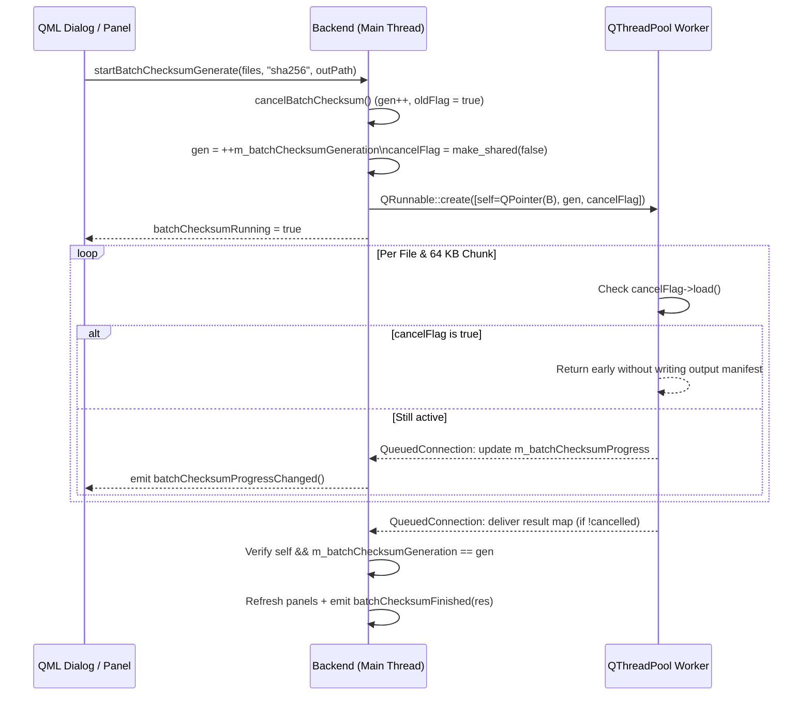
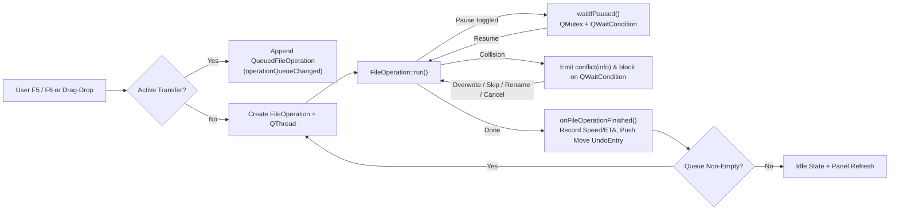

# TwinForge Architecture

**TwinForge** (`twinforge` / `tf`) is a native Linux dual-panel file manager built with **C++20**, **Qt 6 (Quick / QML + Core / Gui / Concurrent / Network / DBus)**, and **libarchive**. Its core design keeps the QML UI thread strictly non-blocking (`60+ FPS`) while running filesystem traversal, hashing, thumbnails, archive indexing, previews, search, synchronization, and file transfers on background workers with generation-guarded cancellation.

---

## 1. High-Level Layered Architecture

```mermaid
flowchart TB
    subgraph UI["Presentation Layer (QML / Qt Quick)"]
        QML["Main.qml\nDual Panels, Tabs, Command Palette, Dialogs"]
        ThumbImg["image://thumb/\nAsync Thumbnail Requests"]
    end

    subgraph Core["Application Core & State (C++20 / QObject)"]
        MainCpp["main.cpp\nApp Bootstrap, CLI, Re-translation"]
        Backend["Backend\nActions, Queue, Preferences, Async Orchestration"]
        LeftPanel["PanelModel (Left)\nQAbstractListModel, Tabs, Git, Sort/Filter"]
        RightPanel["PanelModel (Right)\nQAbstractListModel, Tabs, Git, Sort/Filter"]
        Theme["Theme\nOmarchy/Hyprland Accent & Radius Watcher"]
        Translator["Translator\nQTranslator + Live Language Override (EN/RO)"]
        IPC["SingleInstance\nQLocalServer / QLocalSocket IPC"]
    end

    subgraph Workers["Concurrency & Background Engines"]
        ThreadPool["QThreadPool (Global)\nSearch, Dupes, Sync, Checksums, Preview, Split"]
        FileOpThread["Dedicated QThread\nFileOperation (Copy/Move/Conflict/Pause/Resume)"]
        ThumbProvider["ThumbnailProvider\nQQuickAsyncImageProvider + Dedicated Pool"]
    end

    subgraph System["Linux / Freedesktop / External Tools"]
        FS["Local Filesystem & Symlinks"]
        XDG["Freedesktop XDG\ntrash://, mimeapps.list, ~/.cache/thumbnails"]
        LibArchive["libarchive\n.zip, .tar.*, .7z Virtual Browsing"]
        CLI["External Processes\nrclone, gio, sshfs, lsblk, udisksctl, zoxide, pdftoppm, ffprobe"]
    end

    QML <-->|Q_PROPERTY / Q_INVOKABLE / Signals| Backend
    QML <--> LeftPanel
    QML <--> RightPanel
    QML -->|Bindings| Theme
    ThumbImg -->|Async| ThumbProvider

    MainCpp --> IPC
    MainCpp --> Translator
    MainCpp --> Theme
    MainCpp --> Backend
    Backend *-- LeftPanel
    Backend *-- RightPanel

    Backend -->|Spawns| ThreadPool
    Backend -->|Owns Worker| FileOpThread
    Backend --> LibArchive
    Backend --> XDG
    Backend --> CLI
    FileOpThread --> FS
    LeftPanel --> LibArchive
    RightPanel --> LibArchive
    LeftPanel --> FS
    RightPanel --> FS
```

---

## 2. Asynchronous Worker Cancellation & Generation Guard Pattern

Long-running reads and background analyses never touch the GUI thread directly. Every cancellable subsystem on `Backend` (`Search`, `DuplicateScan`, `Sync`, `Checksum`, `BatchChecksum`, `ModalPreview`, `QuickViewPreview`, `ArchiveOp`, `RemoteOp`, `SplitOp`, `Drives`) and `PanelModel` (`FolderSizes`, `GitStatus`) pairs:

1. **Monotonic Generation Counter** (`std::atomic<quint64>` / `quint64`), incremented on every new request or cancellation.
2. **Shared Cooperative Cancel Token** (`std::shared_ptr<std::atomic<bool>>`), checked inside inner I/O loops (e.g. 64 KB hash chunks in `computeChecksumsImpl`, directory iterators in search/sync).
3. **`QPointer<Backend>` Weak UI Callback** via `QMetaObject::invokeMethod(..., Qt::QueuedConnection)`, dropping stale progress/completion events if a newer generation started or `Backend` is being destroyed in `~Backend()`.



---

## 3. File Transfer Engine & Operation Queue

Multi-file copy (`F5`) and move (`F6`) jobs flow through a serialized **Operation Queue** (`m_operationQueue`) backed by a dedicated `QThread` running `FileOperation`:



Key invariants in `src/fileoperation.cpp`:
- **Pause/Resume & Conflict Resolution:** Managed through `QMutex` + `QWaitCondition` inside `FileOperation`, ensuring zero CPU spin when paused or awaiting user choice, and accounting active elapsed time via `activeElapsedMs()` for accurate `MB/s` and `ETA` calculations.
- **Cross-Filesystem & Symlink Safety:** `copySymlink` / `moveSinglePath` preserve symbolic links via POSIX `readlink` (`FileOperation::readRawSymLink`) without touching symlink targets, and fall back cleanly to copy-then-remove across mountpoints (`EXDEV`), retaining every source file until its destination `QSaveFile::commit()` succeeds.
- **Interrupted Transfer Recovery:** `FileOperation` tracks `completedSources`, `remainingSources`, `interruptedSource`, and `interruptedReason` (on cancellation, missing/unplugged destination, or read/write failure). `Backend` persists unfinished transfers in `session.ini` (`transfer/interruptedJson`) and exposes `retryInterruptedTransfer()` to resume strictly the remaining items once the destination/source is available again.
- **Session & Settings Persistence:** `~/.config/twinforge/session.ini` stores panel tabs/locks, command history, recent directories, theme mode, unfinished transfer recovery state, and the 11 configurable preferences (`fontSize`, `rowHeight`, `customEditor`, `customTerminal`, `confirmCopy`, `confirmMove`, `confirmDelete`, `showExtColumn`, `showSizeColumn`, `showModifiedColumn`, `languageMode`).
- **Workspace-Linked Saved Searches:** Named workspaces (`~/.config/twinforge/workspaces.json`) optionally carry `savedSearches` (root path, filename mask, content pattern, regex/case/filter flags) runnable on demand (`runWorkspaceSavedSearch`) with automatic **Feed to Panel** result streaming.

---

## 4. Single-Instance IPC & CLI Routing

On launch, `main.cpp` evaluates arguments via `parseCliArguments(...)` in `src/cli.cpp`:
- Info flags (`--help`, `--version`, `--shell-init bash|zsh|fish`) print directly and exit cleanly without spinning up GUI state.
- Standard invocations (`tf /left /right`, `tf -t ~/Downloads`, `tf --select ~/file`) check `SingleInstance::sendToRunningInstance(...)` over a per-user `QLocalSocket` (`SingleInstance::defaultSocketName()`).
- If an existing TwinForge window is listening on `QLocalServer`, the serialized `CliRequest` is forwarded over IPC, triggering `Backend::applyNavigationRequest(...)` + window activation, and the second process exits with code `0`. Passing `-n` / `--new-window` or `--print-last-dir` bypasses forwarding to start a standalone window.

---

## 5. Module Overview & Toolchain Compatibility

| Component | Source Files | Responsibility |
| :--- | :--- | :--- |
| **Entry & IPC** | [`src/main.cpp`](src/main.cpp), [`src/cli.h`](src/cli.h), [`src/cli.cpp`](src/cli.cpp), [`src/singleinstance.h`](src/singleinstance.h), [`src/singleinstance.cpp`](src/singleinstance.cpp) | CLI parsing, shell `tfcd` init, `QLocalServer` single-instance routing, engine & translator wiring |
| **Backend Coordinator** | [`src/backend.h`](src/backend.h), [`src/backend.cpp`](src/backend.cpp) | Settings, transfer queue & recovery, saved workspace searches, async workers (Search, Sync, Duplicates, Batch Checksum, Preview, Split/Combine, Remote mounts), XDG apps & Trash |
| **Command Log Model** | [`src/commandlogmodel.h`](src/commandlogmodel.h), [`src/commandlogmodel.cpp`](src/commandlogmodel.cpp), [`src/CommandOutput.qml`](src/CommandOutput.qml) | Structured per-command `QAbstractListModel` (`cwd`, `command`, `output`, `exitCode`, `timestamp`) and modular standalone drawer component |
| **File Operation Worker** | [`src/fileoperation.h`](src/fileoperation.h), [`src/fileoperation.cpp`](src/fileoperation.cpp) | Threaded recursive Copy/Move, pause/resume, conflict resolution, symlink & cross-FS handling, remaining-item tracking |
| **Panel List Model** | [`src/panelmodel.h`](src/panelmodel.h), [`src/panelmodel.cpp`](src/panelmodel.cpp) | `QAbstractListModel`, multi-tab state & drag-reordering, tab locking, flat branch view, `libarchive` virtual FS, disk usage & Git status |
| **Thumbnail Cache** | [`src/thumbnailprovider.h`](src/thumbnailprovider.h), [`src/thumbnailprovider.cpp`](src/thumbnailprovider.cpp) | Async `image://thumb/` provider implementing Freedesktop `~/.cache/thumbnails/{normal,large}` MD5 PNG specification |
| **Theming & i18n** | [`src/theme.h`](src/theme.h), [`src/theme.cpp`](src/theme.cpp), [`src/translator.h`](src/translator.h), [`src/translator.cpp`](src/translator.cpp) | Dynamic Omarchy/Hyprland accent/radius watching and JSON translation catalog (`en` / `ro`) with live runtime override |
| **UI Shell** | [`src/Main.qml`](src/Main.qml), [`src/CommandOutput.qml`](src/CommandOutput.qml) | Dual-panel Qt Quick UI, modular command drawer, themes, Command Palette, previewers, batch tools, settings dialog |
| **Test Suite** | [`tests/twinforge_tests.cpp`](tests/twinforge_tests.cpp) | 69 `QtTest` offscreen verification tests covering core models, workers, recovery, IPC, archives, settings, standalone QML components, and full QML root instantiation |

**Qt Compatibility Policy:** Development builds target **Qt 6.12+** (Arch Linux / C++20), while GitHub Actions CI ([`.github/workflows/ci.yml`](.github/workflows/ci.yml)) compiles and executes the full headless test suite under `xvfb-run` on **Ubuntu 24.04 LTS (Qt 6.4.2)** to guarantee broad Linux distribution compatibility.
