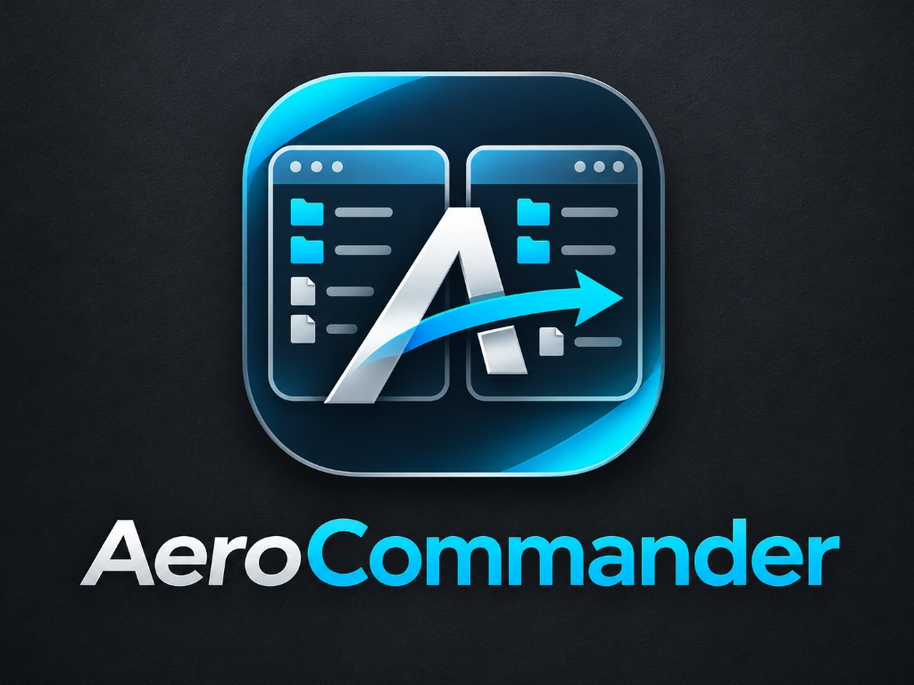

<p align="center">
  
</p>

<h1 align="center">AeroCommander</h1>

<p align="center">
  <b>A fast, modern dual-panel orthodox file manager for Linux, inspired by Total Commander and tailored for modern Linux desktops & Omarchy.</b>
</p>

<p align="center">
  
  
  
  
  
</p>

---

## 🌟 Key Features

### 📂 Dual-Panel Workflow & Per-Panel Tabs
- **Independent Panels:** Dual-panel orthodox layout with swift keyboard switching (<kbd>Tab</kbd>).
- **Per-Panel Tabs:** Open and close multiple tabs independently in each panel (<kbd>Ctrl+T</kbd>, <kbd>Ctrl+W</kbd>, <kbd>Ctrl+Tab</kbd>).
- **History & Breadcrumbs:** Complete back/forward directory history per tab (<kbd>Alt+Left</kbd>, <kbd>Alt+Right</kbd>) and clickable breadcrumbs (<kbd>Ctrl+L</kbd> for manual path input).
- **Panel Synchronization:** Swap panels (<kbd>Ctrl+U</kbd>) or sync target directory with active panel (<kbd>Alt+=</kbd>).

### ⚡ Batch Creation & CSV Text Export
- **Multiple File & Folder Creation:** In addition to single items, both **New Folder (<kbd>F7</kbd>)** and **New File (<kbd>Shift+F4</kbd>)** support comma-separated lists (e.g. `doc1.txt, doc2.txt, notes.md` or `src, include, assets/icons`).
  - Automatic whitespace trimming and skipping of empty segments.
  - Automatic recursive parent directory creation (`mkpath`).
  - Live count preview badge inside the dialog (`Will create X files/folders`).
- **Copy as CSV Text to Clipboard:**
  - **Copy Name(s) as Text (<kbd>Ctrl+Shift+C</kbd>):** Copies selected item names (or all names in directory) as `name1, name2, name3`.
  - **Copy Path(s) as Text (<kbd>Ctrl+Alt+C</kbd>):** Copies absolute paths as `path1, path2, path3`.
  - Also accessible via item right-click context menu, background context menu, and the Edit top menu.

### 🖱️ Comprehensive Mouse & Context Menu Interaction
- **Selection Modifiers:** Standard <kbd>Ctrl</kbd>+Click to toggle items and <kbd>Shift</kbd>+Click for contiguous range selections.
- **Rubberband / Marquee Area Drag:** Click and drag across items or from the empty space below to select rectangular areas (hold <kbd>Ctrl</kbd> to add to existing selections).
- **Context Menus:**
  - **Item Right-Click Menu:** Open/View, Cut, Copy, Copy as CSV Text, Paste, New File, New Folder, Rename, Delete, and Properties.
  - **Background Right-Click Menu:** Quick Paste, Copy All Names/Paths in Folder, New File, New Folder, Select All, Refresh, and Open Terminal Here.
  - Clean styling with zero empty rows and automatic dismissal on click outside or <kbd>Esc</kbd>.

### 🛡️ Safety, Permissions & Read-Only Detection
- **Safe Background File Operations:** Multi-threaded copy/move with byte-level progress reporting and instant cancellation (<kbd>Cancel</kbd>).
- **Conflict Handling:** Interactive prompt on file collision (*Overwrite*, *Skip*, *Rename to (1)*, *Cancel*, with optional *Apply to all*).
- **Read-Only Detection:** Automatic detection of non-writable system folders (e.g. `/home`, `/etc`, `/usr`):
  - Displays a visible `[Read-Only]` / `[Doar citire]` badge in the panel breadcrumb bar.
  - Displays prominent warnings inside creation dialogs with descriptive permission error feedback.

### 🖼️ View Modes & Previews
- **List & Grid Thumbnail Views:** Toggle between Total Commander-style detailed list (<kbd>Ctrl+1</kbd>) and visual image thumbnail grid (<kbd>Ctrl+2</kbd>).
- **Quick View (<kbd>Ctrl+Q</kbd> / <kbd>F3</kbd>):** Live preview in the opposite panel for text, images, syntax, and metadata.

### 🛠️ Advanced Tools
- **Git Status Tracking:** Live repository detection showing branch name, modified count, untracked count, and badges (`M`, `?`, `A`, `D`) per item.
- **Checksum Calculation & Verification:** MD5, SHA-1, and SHA-256 calculation, live matching against clipboard hashes, and `.sha256` / `.md5` file verification.
- **Visual File Diff (<kbd>Ctrl+Alt+D</kbd>):** Side-by-side visual diff showing additions, deletions, and modifications between two files or panel selections.
- **Multi-Rename Tool (<kbd>Ctrl+M</kbd>):** Batch rename with search-and-replace, numbering counters, prefix/suffix additions, and live preview.
- **Undo Stack (<kbd>Ctrl+Z</kbd>):** Undo recent renames, moves, and Trash deletions.
- **Properties & Permissions (<kbd>Alt+Enter</kbd>):** Interactive 3×3 `chmod` matrix, octal permission input, owner/group info, and recursive directory apply.
- **Symbolic Link Creation (<kbd>Ctrl+Shift+F5</kbd>):** Fast relative or absolute symlink creation.
- **Archive Pack & Extract:** Pack to `.zip` / `.tar.gz` (<kbd>Alt+F5</kbd>) and extract (<kbd>Alt+F9</kbd>).
- **Session Persistence:** Remembers open tabs, active panel, sorting, hidden-files state, and window dimensions across restarts (`~/.config/omapanel/session.ini`).
- **Removable Drive Mounting:** Discovers unmounted partitions via `lsblk` with 1-click mounting via `udisksctl` and 1-click eject.

---

## ⌨️ Keyboard Shortcuts

| Shortcut | Description |
| :--- | :--- |
| <kbd>Tab</kbd> | Switch active panel (Left / Right) |
| <kbd>Ctrl+T</kbd> / <kbd>Ctrl+W</kbd> | New tab / Close active tab in panel |
| <kbd>Ctrl+Tab</kbd> / <kbd>Ctrl+Shift+Tab</kbd> | Next / Previous tab in active panel |
| <kbd>Ctrl+1</kbd> / <kbd>Ctrl+2</kbd> | Detailed List view / Grid Thumbnails view |
| <kbd>F3</kbd> / <kbd>Ctrl+Q</kbd> | View file / Toggle live Quick View in opposite panel |
| <kbd>F4</kbd> | Edit file in default `$EDITOR` |
| <kbd>Shift+F4</kbd> | Create new file (or multiple files via comma) |
| <kbd>F5</kbd> / <kbd>F6</kbd> | Copy / Move selected items to opposite panel |
| <kbd>F7</kbd> | Create new folder (or multiple folders via comma) |
| <kbd>Shift+F6</kbd> / <kbd>Ctrl+M</kbd> | Quick rename / Batch Multi-Rename tool |
| <kbd>F8</kbd> / <kbd>Delete</kbd> | Delete selected items (Trash or permanent) |
| <kbd>F9</kbd> / <kbd>Alt+T</kbd> | Open terminal in current directory |
| <kbd>F10</kbd> | Exit application |
| <kbd>Ctrl+C</kbd> / <kbd>Ctrl+X</kbd> / <kbd>Ctrl+V</kbd> | Copy / Cut / Paste via system clipboard |
| <kbd>Ctrl+Shift+C</kbd> | Copy selected names as comma-separated text |
| <kbd>Ctrl+Alt+C</kbd> | Copy selected paths as comma-separated text |
| <kbd>Ctrl+Z</kbd> | Undo last rename, move, or trash operation |
| <kbd>Alt+Enter</kbd> | Properties & interactive `chmod` permissions |
| <kbd>Ctrl+Shift+F5</kbd> | Create symbolic link in target panel |
| <kbd>Ctrl+Alt+D</kbd> | Visual side-by-side text file diff |
| <kbd>Num+</kbd> / <kbd>Num-</kbd> | Select / deselect by wildcard pattern (e.g. `*.jpg`) |
| <kbd>Num*</kbd> / <kbd>Ctrl+Shift+A</kbd> | Invert selection |
| <kbd>Alt+F7</kbd> | Recursive file search |
| <kbd>Ctrl+H</kbd> | Toggle hidden files |
| <kbd>Ctrl+S</kbd> | Quick filter active panel |
| <kbd>Ctrl+B</kbd> | Bookmark manager |
| <kbd>Ctrl+U</kbd> / <kbd>Alt+=</kbd> | Swap panels / Sync target to active panel |
| <kbd>?</kbd> / <kbd>F1</kbd> | Interactive keyboard shortcuts overlay |

---

## 🚀 Building & Installation

### Prerequisites
- **Qt 6:** `qt6-base`, `qt6-declarative`, `qt6-quickcontrols2`
- **C++ Compiler:** GCC or Clang with C++20 support
- **Build Tools:** `qmake6` and `make`

### Build
```bash
./bin/build
```
Binary will be created at `./build/omapanel`.

### Run Test Suite
```bash
./bin/test
```
Runs the full automated test suite verifying file operations, multi-selection, CSV exports, undo stack, git tracking, diffing, and permissions.

### Install on Arch Linux / Omarchy
```bash
./bin/install
```
Installs the binary to `~/.local/bin/omapanel` and places desktop entries and icons in standard XDG directories.

---

## 🌐 Localization
AeroCommander includes dynamic runtime localization:
- English (default)
- Romanian (Română)

Translations can be edited directly in `src/i18n/`.

---

## 📄 License
GPL-3.0 License. Inspired by Christian Ghisler's legendary Total Commander.
